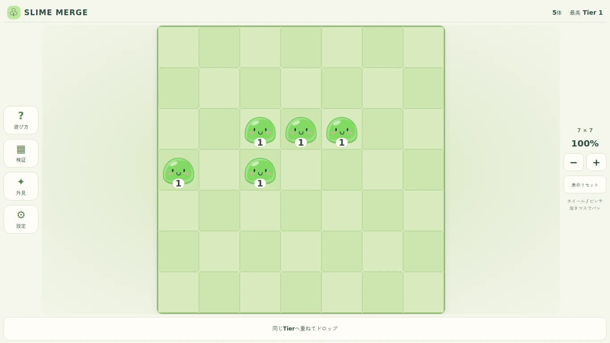
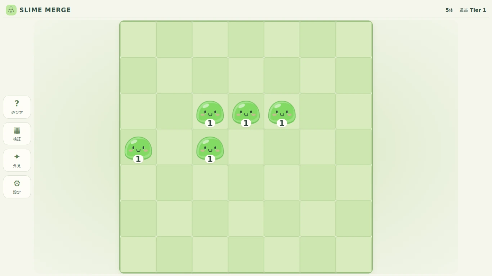
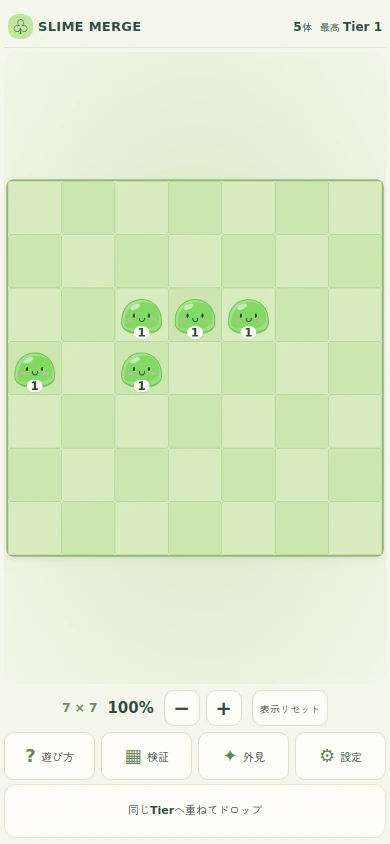
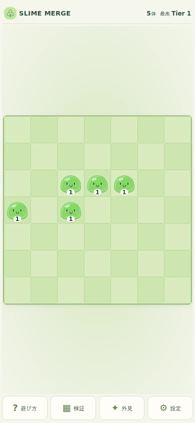

# Phase 1.1 Polish 検証結果

検証日：2026-10-31（日本時間）。開始main `bacbc2b9b53b7e3d11758242a49a415e1f91c259`、Private。PR #6はマージ済み、新しい`fix/phase1-1-compact-ui-spec-v027`だけを更新する。

## 結果

- npm ci成功（178 packages）、ESLint成功（警告0）、Vitest **214/214 PASS、7ファイル、失敗0・skip0**、型チェック・本番Build成功。
- Chromium 134.0.6998.35 / Playwright 1.51.1、本番distに対する**従来100＋追加20＝120項目 PASS**、既存マージ回帰**54項目 PASS**。計174項目、失敗・skip・pageerror・console error・request failureは0。
- 変更前mainも同じ環境でBuildし、従来100項目を別途実行して全成功（変更後の174件へは加算しない）。同ブラウザ再計測とPR #6保存JSONを全10サイズで照合した。
- 指定10サイズすべてでdocumentのscroll幅／高さがclient幅／高さと一致。html/bodyへoverflow:hidden/clipを設定して隠していない。
- `.result-bar`、右の`.camera-controls`、盤面寸法、現在倍率の可視常設表示を削除。高さを確保しない1pxの非表示aria-live通知を維持。
- 拡大・縮小・表示リセットは設定内。44px以上のタップ領域、キーボード選択・Enter操作、閉じた後のフォーカス復帰を全サイズで検証。

## 全10サイズの前後比較

| 画面 | 変更前 W×H (px) | 変更後 W×H (px) | 画面面積占有率 前→後 | 盤面面積の増加 |
|---|---:|---:|---:|---:|
| 1920×1080 | 952×952 | 1010×1010 | 43.7% → 49.2% | +12.6% |
| 1440×900 | 772×772 | 830×830 | 46.0% → 53.2% | +15.6% |
| 1366×768 | 640×640 | 698×698 | 39.0% → 46.4% | +18.9% |
| 1280×720 | 592×592 | 650×650 | 38.0% → 45.8% | +20.6% |
| 1024×768 | 640×640 | 698×698 | 52.1% → 62.0% | +18.9% |
| 768×1024 | 752×752 | 752×752 | 71.9% → 71.9% | +0.0% |
| 390×844 | 374×374 | 374×374 | 42.5% → 42.5% | +0.0% |
| 375×667 | 359×359 | 359×359 | 51.5% → 51.5% | +0.0% |
| 320×568 | 304×304 | 304×304 | 50.8% → 50.8% | +0.0% |
| 844×390 | 288×288 | 334×334 | 25.2% → 33.9% | +34.5% |


計測は同じ5体プリセット、フィット倍率1、deviceScaleFactor=1。W/Hは盤面DOMの変換後境界で外枠outlineを含めない。画面面積占有率は盤面W×H／viewport面積、増加率は旧盤面面積に対する相対変化。

PCは52pxのログ行＋6pxのgapをすべて盤面へ再配分し一辺58px増。844×390は42px＋gap4pxから46px増。縦長のスマホと768×1024は幅が制約で、マスを維持したまま下部ログとズーム行を撤去した。左メニューに対応する右側の余白を対称にすることで、盤面の水平中心を画面中心に一致させる。右側の操作パネルは存在しない。

## ブラウザ操作・マージ回帰

`tests/browser/phase1-1.cjs`は従来の10項目×10画面を維持し、各画面に不要UI撤去・ページ中央配置と設定内キーボード補助操作の2項目を追加（計120）。既存54件は表示リセットの呼び出しだけ新しい設定経由へ追従し、判定期待値は変更していない。

- 3／5／8／11体、斜め、5体優先・余り保全、高Tier、39→40、40上限、異Tier重ね、空マス移動、盤面外の無消費取消。
- ズーム＋パン後の3／5／11体で素材ID・出力座標・余りがプレビューと確定で一致。
- ホイールのカーソル中心保持、ピンチ中点保持、75〜300%の制限、ヘッダー寸法不変、設定からの表示リセット。
- CDPタッチによる素材ドラッグ→2本目で取消、残指の誤マージ抑止、touchCancel・blur・3本目、全指を離した後の回復。
- リサイズ／縦横回転中の取消・refitと、その後の座標変換・正常マージ。
- 全40Tier外見、設定・遊び方・プリセット／盤面リセット、ダイアログの表示領域と内部スクロール。

テスト準備中に、変更前ページのResizeObserver適用前（盤面1px）を測る待機不足を発見し、盤面が初期化された条件を待つよう修正した。また、54件runnerの旧位置のリセット操作を設定経由へ修正。これらは検証コードの追従であり、マージCoreや入力ロジックの修正を伴わない。最終結果は修正後runnerの全件再実行値。

## 変更範囲・仕様保全

アプリ変更は`GameBoard.tsx`（下部ログ・右操作欄撤去、設定へcallback）、`GameMenu.tsx`（補助操作）、`global.css`（ログ行撤去、中央配置・レスポンシブ、非表示通知）だけ。Core・domain・カメラ・ジェスチャー・プリセット・package/lockfile・CIは開始mainとGit blob SHAで全件一致。7×7・49セル・Tier40を維持し、土地・GOLD・生成・貯蔵・追加ボタン・図鑑ロックを実装していない。

v0.2.7はv0.2.6の1309行全文をベースとして1385行へ改訂。旧版はGit blob不変。v0.2〜v0.2.6の改版履歴は原文一致、v0.1から継承した本文・決定履歴を残し、既存M36＋A14＋E20＝70のテストIDをすべて維持。土地・図鑑・追加UI・保存・ロードマップ・開発状態の本文を更新し、新しい受入条件を追加した。価格・最大区画数・4方向隣接の確定度は区別した。

## 証跡・画像

- [全実測・120件JSON](browser-results.json)、[54件JSON](regression/results.json)、[計測表](measurements.md)
- [Core・旧仕様保全](core-preservation.json)、[仕様の履歴・テスト保全](spec-preservation.json)、[試験対象SHA-256](tested-source-manifest.json)
- コマンドログ：`npm-ci.txt`、`lint.txt`、`vitest.txt`、`build.txt`、`browser-run.txt`、`regression-run.txt`
- 全10サイズの`before-幅x高さ.webp`と`screen-幅x高さ.webp`は、**今回同一環境で撮影した変更前mainと変更後**。旧PRの画像は別ディレクトリのまま保全。runner出力PNGを同じ寸法のWebPへ変換して保管。

### PC 1366×768

変更前：



変更後：



### スマホ 390×844

変更前：



変更後：



## 環境と未確認事項

Node22.23.4 / npm10.9.9、Linux、隔離Playwright1.51.1／Chromium134（前回と同じ版）。日本語QA用Zen Maru Gothicをホストに準備し、アプリ・リポジトリ・lockfileへ追加していない。ブラウザは公式配布ミラーから取得。npmログのUNDICI警告は実行環境のproxyエージェントの警告であり、ESLint警告ではない。

PC・スマホの変更前後画像、320px画面、横画面、設定／外見・プレビュー画像を目視確認。操作はPlaywrightマウスとCDPタッチ入力による**エミュレーション**。独立したCloud Browserでlocalhostを開く操作確認は別ホストのためERR_CONNECTION_REFUSEDとなり実施できなかった。

**未実施：正規Windows Chrome/Edge、実iPhone/iPad Safari、実Android Chrome、Safari/WebKit・Firefox、実機safe-area／ノッチ／ブラウザバー／OSジェスチャー、低性能端末や長時間FPS。実機成功とは報告しない。** 実施範囲で残存不具合は検出していない。ユーザーの画面確認と新規Draft PRの採用判断を待つ。

## 再実行

Node22/npm10と隔離Playwright1.51.1＋Chromium shellを準備する。通常試遊にPlaywrightは不要。先にnpm ci／lint／test -- --run／buildを実行後、`PLAYWRIGHT_MODULE`へPlaywrightの絶対パスを指定する。

```sh
node tests/browser/phase1.cjs
node tests/browser/phase1-1.cjs
```

`BROWSER_ARTIFACT_DIR`で出力先、`GAME_URL`で既存ローカルサーバーを指定。`BASELINE_DIR`に開始mainを別ディレクトリでBuildしたパスを指定すると全10サイズの前後比較も実行する。未指定なら前後比較を除く操作・レイアウト120項目。各runnerは順番に実行し、デフォルトではpreviewサーバーを起動・終了する。
