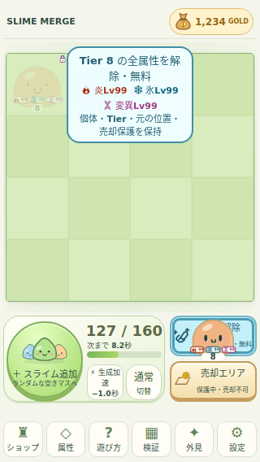
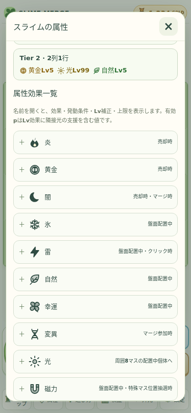

# Phase3B.1 検証結果 — 2026-11-01

最新main e3096b8（PR #11マージ済み）から新規feature/phase03b1-attribute-management-polish。main CI41302209242成功・同SHAを確認。今回も別Draft PR、main未マージ。最新GitHub HEADと対応CI URLは新規Draft PR本文へ記録する。Private/Pages設定維持。

## 自動試験

- Node22.23.4/npm10.9.9で `npm ci` 成功。562件の既存ベースライン成功（baseline-vitest.txt）。
- `npm run lint` 成功（lint.txt）、`npm test -- --run` **659/659件・25ファイル**成功（vitest.txt）、`npm run build` 型チェック含め成功（build.txt）。依存/CI変更なし。
- 既存562件を削除せず、FIFO追加18・解除38・貯蔵27・容量比較1・ガイド13=97件追加。旧安全素材テストは新FIFO合意へ期待値を更新。旧検証資料への出力だけ今回のregressionへ変更し、過去資料は不変。
- FIFO9/10/11以上・属性/高Tier・残存順序・最小Tier・35%境界・無保証・満杯/期待ID/モード/連打拒否、保存失敗/CAS/復旧を検証。
- 解除1〜3属性・no-op・ID/位置/Tier/保護/GOLD/他個体・10効果/複合終了・生成進捗率・自然供給の終了・GOLD凍結契約・古いプラン無効・保存ロールバックを検証。
- 旧schema1〜5は旧Lv16/旧容量で検証後移行、schema6の既存Lv16/58在庫と購入履歴を保持し容量90へ再評価。schema6/160在庫の生成上限/FIFO/重視/保存も検証。未知/不正/破損は原文保持。
- 独立した所有/位置/個体数/属性/不変性/保存不変条件で4seed×5,000=20,000混合操作、違反0。第三者レビューとは区別する（AUDIT.md）。

## ブラウザ

**626件成功・失敗0・page/console error0。** 従来530件の全8runnerを本番ビルドで再実行し、新規92操作+実時計性能4件を追加。Chromium134.0.6998.35/Playwright1.51.1、マウス/ネイティブCDPタッチ、モバイル・画面エミュレーション。実機/全ブラウザ/実スクリーンリーダー利用者は未確認。アプリの状態改造用フックや実装依存を追加せず、保存fixtureから読み込み、公開DOMと実入力で試験する。

| suite | 成功 | 失敗 |
|---|---:|---:|
| browser | 92 | 0 |
| followup | 101 | 0 |
| followup-compare | 3 | 0 |
| performance-browser | 4 | 0 |
| phase1 | 54 | 0 |
| phase1-1 | 120 | 0 |
| phase2-polish | 60 | 0 |
| phase3a | 74 | 0 |
| phase3b | 82 | 0 |
| polish-input | 36 | 0 |

全10サイズでdocumentの縦横スクロールなし。盤面の辺は従来測定値と一致し縮小なし。解除の下端と売却の上端に空き、各ヒット域が44px以上・重複なし。127/160の大型表示が見切れない。10SVGと3属性Lv99のバッジが顔/Tierと重ならない。属性ダイアログ内のみスクロールし、10項目と3複合・未所持項目/キー操作を確認。

| 画面 | 盤面の辺 | 解除/売却高さ | 貯蔵フォント | 全体スクロールなし |
|---|---:|---:|---:|---|
| 1920×1080 | 1010px | 81.5/148px | 27px | 成功 |
| 1440×900 | 830px | 81.5/148px | 27px | 成功 |
| 1366×768 | 698px | 81.5/148px | 27px | 成功 |
| 1280×720 | 650px | 81.5/148px | 27px | 成功 |
| 1024×768 | 624px | 81.5/148px | 27px | 成功 |
| 768×1024 | 752px | 50/50px | 20px | 成功 |
| 390×844 | 374px | 50/50px | 20px | 成功 |
| 375×667 | 359px | 50/50px | 20px | 成功 |
| 320×568 | 304px | 50/50px | 18px | 成功 |
| 844×390 | 334px | 44/44px | 21px | 成功 |

全サイズで保護個体をドラッグ→解除予告→無料解除→元セル保持→reload、無属性no-op、売却との区別、キーボード解除、属性アイコン/一覧、FIFOの属性・高Tier消費/残存復旧、貯蔵29→30/速度tap16上限を操作。1366/390でEscape/pointercancel/ピンチ/blur/画面回転取消。390でGOLD4/10中の解除→凍結契約保持→reload後1回だけ支給と、Quota/別タブ原文競合拒否を追加確認。既存runnerで3/5/8/11マージ、交換、研究、売却、長押し/右クリック、ホイール/パン/ピンチ、7×7、GOLD10回/二重受給防止、セーブ回復を回帰。

新規試験初回はtouchmove直後のDOM更新待機が不足し、プレビュー消滅の確認が先行して失敗。検証コードに条件待機を追加し、92/92成功。実装の期待値や不変条件は緩めていない。決定的操作試験の時計制御下のhot-I/Oゼロ値は性能根拠から除外し、別の実時計4ケースで測り直した。性能runner初回は初期セーブがまだ未作成のfixture初期化に失敗、必須フィールドを明示して再実行4/4成功。

## 性能・画像・限界

容量10/58/100/160の36在庫モデルと100回/サイズのCore計測、実時計LocalStorage1,000回/サイズは[比較結果](../../balance/phase3b1/RESULTS.md)。Node最大JSON16,559bytes、ブラウザの時刻付き16,602bytes。ホットな同一値のI/OはディスクflushやWeb Locksの時間ではない。ドライバーを含む操作/リロード時間をゲーム処理単独の速度と混同しない。

21枚をlossless WebPで保存、切抜き/縮小なし。[manifest](screenshots/manifest.json)に元PNG、寸法、SHA256を記録。画像生成は使わず、アイコンはSVGソース。

全件の機械可読一覧は[summary.json](summary.json)、従来回帰はregression-browser、新規92件はbrowser/results.json、実時計4件はperformance-browser/results.json。確認範囲外の実機は成功扱いしていない。最終的な容量価格/既存属性効果の正式値は試遊評価後。紫青/覚醒/外見全面改修/音/土地は後続。
