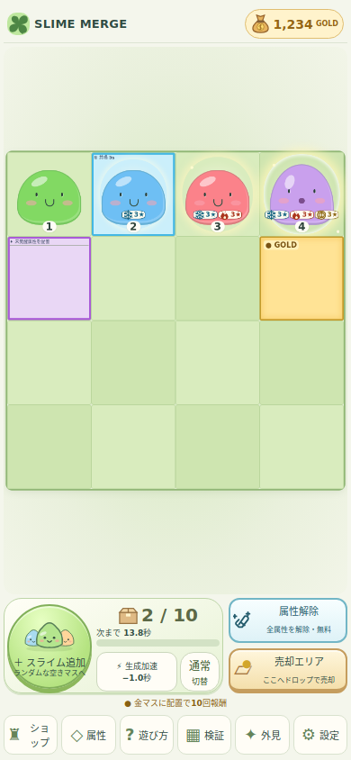
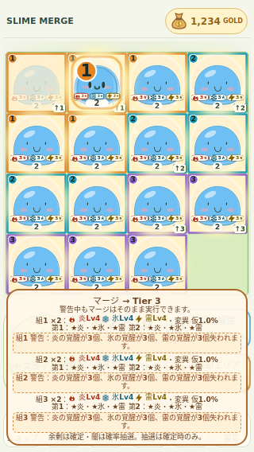
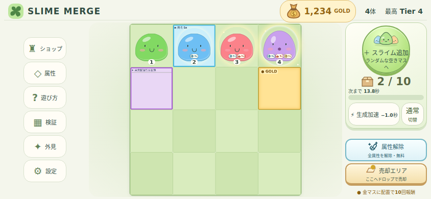

# Phase3C 最終検証 — 2026-11-02 JST

PR #13を試遊可能な完成版へ更新。最終GitHub HEAD/同SHA CIはPR本文を参照。mainへはマージしない。初期復旧の未完成報告と区別し、本節が現在の検証結果。

## 自動試験

Node22/npm10、npm ci（recovery-npm-ci.txt）・Lint（final-lint.txt）・Vitest713件/28ファイル（final-vitest.txt、192.54秒）・Build/型チェック（final-build.txt）成功。既存659＋集中配分21＋紫青/保存/効果32＋比較1。既存ケースは削除せず、version期待6→7と新しいboolean型に対応した旧不正値の更新を記録する。

9合意例、32,768配分、3/5/8/11/13/15体、余り、確定余剰と闇抽選の順序、32特殊ケース、schema6のLv30/160 FIFO/4回支給済み契約を含む移行、Quota/CAS、時間境界・進捗率、自然上限を検証。旧1〜5・研究・売却保護・GOLD・別タブ/SessionStoreの既存回帰も含む。

## ブラウザ706件

旧530（phase1-1:120、phase3a:74、followup:101、polish-input:36、phase2-polish:60、phase1:54、followup-compare:3、phase3b:82）＋Phase3B.1:92＋実時計性能4＋新Phase3C:80。全件成功。raw JSONと各run.txt、summary.jsonを参照。Chromium134/Playwright1.51.1のエミュレーションであり実機ではない。

1920×1080、1440×900、1366×768、1280×720、1024×768、768×1024、390×844、375×667、320×568、844×390。ページ全体スクロールなし、従来盤面寸法、売却/無料解除の非重複、127/160表示を既存回帰で確認。新規は各サイズ8件：金紫青/0〜3オーラ、本体形状、集中継承/再ロード、確定余剰/取消/ダイアログなし、15体3組・18保持覚醒、紫離脱/成功/保持、無料解除、青交換/期限、10属性一覧/内部スクロール/減速設定を確認。

Native CDP touchとマウスを使い分け。操作用仮想時計は性能の根拠に使わない。性能4件は実時計で容量10/58/100/160、Tier40/Lv99個体、LocalStorage読取/parse/同値書込を測定。hot I/Oでありdisk flush/端末固有性能の保証ではない。スライム顔/本体/Tierを画像でも確認した。

## 修正・旧期待値

- 覚醒配分は確定してから組単位の闇抽選を適用。プレビュー乱数0、闇リスクは余剰と別。
- rulesOverrideを相対比率で再評価し、購入後/効果変化後の生成進捗上限を保全。
- 本体positionのCSS上書き、警告fixed幅のshrink-to-fit、小画面3組の縦長表示を修正。
- 旧dark-risk検査は新組別sectionに合わせ、closestのpreview containerでクリップ/ドラッグより上のz-indexを確認。
- followupの初期saveを待ってから70秒fastForwardし、初期化の非同期raceを除去。初期ロック/Tier発見を検査する条件は保持。画像用にシステム日本語フォントを準備（ゲーム依存には追加しない）。

## 画像

screenshots/manifest.jsonの21枚は元PNGとRGB画素一致を検証したlossless WebP。10サイズ全景＋4サイズの通常/大量警告＋スマホ/横画面の一覧。元PNG/変換後SHA256・寸法を記録。以下は代表例。

## 残る確認

実Windows/実iPhone/iPad/Android・Safari/Firefox・スクリーンリーダーは未確認。数値は全て仮値、320幅の大量警告はコンパクト表示なので実機で読みやすさを評価する。高品質アート/音/土地/図鑑は対象外。素材外部供給を仮定した比較モデルと人の育成速度を同一視しない。試遊後に限定調整・マージ判断を行う。
